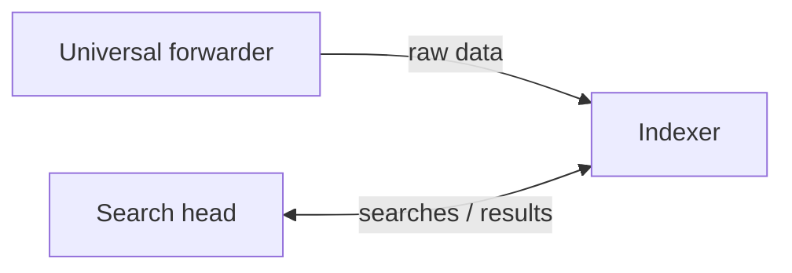

# 1. Splunk Basics (5%)

> **In one sentence:** Splunk is a search engine for machine data. Forwarders ship logs in,
> indexers store them by time, and the search head is where you ask questions.

## 1.1 Splunk components

**Concept:** Data moves through three stages: input (collect) → parsing and indexing
(break into events, timestamp, store) → search (query and visualize).

| Component | Job |
| --- | --- |
| Universal forwarder | Lightweight agent on servers that sends raw data to indexers |
| Indexer | Parses data into events, stamps each with `_time`, stores it in indexes, runs searches on its data |
| Search head | Splunk Web: where users search and build reports and dashboards; distributes searches to indexers and merges results |

A single install plays all three roles; large deployments split them across machines.
An **index** is a named data store (`main` is the default), kept in time-based buckets.



**Lab demo:** _which indexes exist in the lab?_

```spl
| eventcount summarize=false index=*
```

**Result:**
<!-- screenshot: images/01-indexes.png -->

**Exam trap:** know which component does parsing/indexing (indexer) vs. the UI (search head).

## 1.2 Uses of Splunk

IT operations (outages, slowness), security (failed logins, suspicious IPs; SIEM via
Enterprise Security), business analytics (sales, web traffic), DevOps troubleshooting.

**My example use case:**
<!-- one or two lines on what the lab data represents -->

## 1.3 Splunk apps

**Concept:** An app is a packaged workspace with its own searches, reports, dashboards,
lookups and settings. **Search & Reporting** is the default app. The **Home** app is the
launcher. Apps come from Splunkbase. An **add-on (TA)** brings data inputs and field
extractions but has no UI.

Knowledge objects have a permission scope: **private**, **app**, or **global**.

**Result:**
<!-- screenshot: Apps menu -->

## 1.4 Customizing user settings

Username (top right) → **Preferences**: time zone, default app, search preferences
(syntax highlighting, line numbers). **Account Settings**: name, email, password.

**Result:**
<!-- screenshot: Preferences dialog -->

## 1.5 Basic navigation

- **Splunk bar:** Apps, Messages, Settings, Activity (→ Jobs, Triggered Alerts), Help, Find
- **App bar (Search & Reporting):** Search, Analytics, Datasets, Reports, Alerts, Dashboards
- Splunk logo returns to Home
- **Roles:** `user` (search, own objects), `power` (share objects, alerts), `admin` (everything)

---

### Self-check
1. Which component stamps `_time` on events?
2. What's the difference between an app and an add-on?
3. Where do you change your time zone?
