# 2. Basic Searching (22%)

> **In one sentence:** You type terms into the search bar, pick a time range, and Splunk
> returns matching events newest first, with a timeline showing when they happened.

All examples use `index=windowslogs`: 12,256 Windows Security and Sysmon events.

## 2.1 Run basic searches

**Concept:**
- `failed password` → both words (AND is implied)
- `"failed password"` → exact phrase
- `fail*` → wildcard
- Boolean operators must be **UPPERCASE**: `AND`, `OR`, `NOT`. Evaluated `NOT` → `OR` → `AND`; use parentheses.
- Search terms are case-insensitive; **field names are case-sensitive**.

**Lab demo: uppercase vs lowercase OR**

| Search | Events |
| --- | --- |
| `index=windowslogs powershell` | 198 |
| `index=windowslogs powershell OR wmi` | 299 |
| `index=windowslogs powershell or wmi` | **0** |

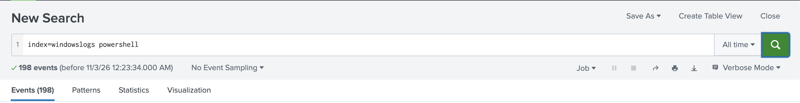
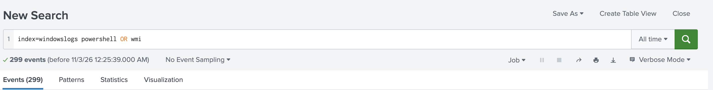
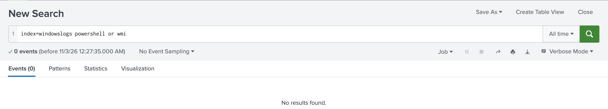

**Why it works:** uppercase `OR` is an operator, so Splunk returned events containing
*either* word (198 PowerShell + 101 more with WMI). Lowercase `or` is just another search
term, so Splunk looked for events containing `powershell` **and** `or` **and** `wmi`,
and none matched.

**Exam trap:** lowercase `and`/`or`/`not` are treated as search terms, not operators.

## 2.2 Set the time range

**Concept:** The time range picker is the biggest performance lever because data is stored
by time. Default: **Last 24 hours**. Presets, relative, real-time, date range, date & time
range, advanced. In SPL, `earliest=` / `latest=` override the picker.

**Lab demo: the data exists, but not in the default window**

With **Last 24 hours**, `index=windowslogs` returns **0 events**:

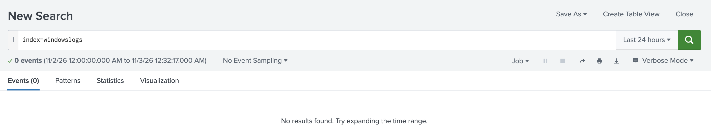

Finding when the data actually is:

```spl
index=windowslogs
| stats min(_time) AS first max(_time) AS last
| eval first=strftime(first, "%F %T"), last=strftime(last, "%F %T")
```

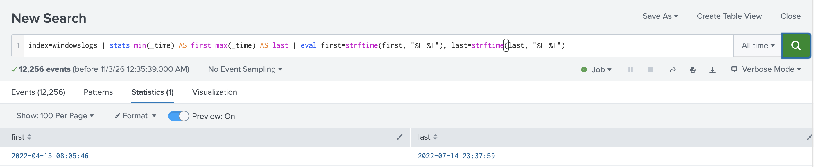

| first | last |
| --- | --- |
| 2022-04-15 08:05:46 | 2022-07-14 23:37:59 |

The data is from 2022, so it only appears with **All time** or a matching date range.
"No results" doesn't always mean no data. Check the time range first.

**Exam trap:** `@d` snaps to the start of the day, so `earliest=-7d@d` = midnight 7 days ago.

## 2.3 Identify the contents of search results

**Concept:** Tabs: **Events**, **Patterns**, **Statistics**, **Visualization** (the last two
fill only with transforming commands). Each event shows `_time`, raw text, and `host`,
`source`, `sourcetype`. The count line shows how many events matched and the time range searched.

In the screenshots above: the event count (e.g. `12,256 events (before …)`), the four tabs,
the time picker, and the search mode (Fast / Smart / Verbose) on the right.

## 2.4 Refine searches

**Concept:** Click a term in an event → *Add to search*, *Exclude from search* (`NOT term`),
or *New search*. More specific = faster.

**Before / after:**

| Search | Events |
| --- | --- |
| `index=windowslogs` | 12,256 |
| `index=windowslogs powershell` | 198 |

Adding one term cut the results by 98%.

## 2.5 Use the timeline

**Concept:** Clicking or dragging across bars filters the results already returned.
Double-clicking, **Zoom to Selection**, and **Zoom Out** change the time range and re-run the search.

**Lab demo:** double-clicking the single bar on the All time timeline:

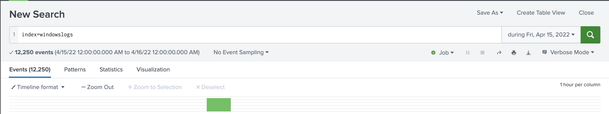

- The time picker changed from **All time** to **during Fri, Apr 15, 2022**
- The search re-ran: **12,250** events (6 fewer; those are from July 14)
- The timeline switched from 1 day to **1 hour per column**; nearly everything happened in one hour

## 2.6 Work with events

**Concept:** Expand an event (`>`) to see all fields. *Event Actions → Show Source* shows
surrounding raw lines. Views: **List**, **Raw**, **Table**.

Expanding a `windowslogs` event shows fields like `EventID`, `Category`, `Channel` and
`EventTime` as name/value pairs. (Screenshots omitted: events contain hostnames and IPs.)

## 2.7 Control a search job

**Concept:** Every search is a job: **Pause**, **Stop** (keeps results so far),
**Finalize**, **Cancel**.

| Mode | Behaviour |
| --- | --- |
| Fast | Field discovery off; fastest |
| Smart (default) | Field discovery on for event searches, off for transforming searches |
| Verbose | All fields and events; slowest |

**Lab demo: Fast vs Verbose on `index=windowslogs`**

| Mode | Interesting fields shown |
| --- | --- |
| Fast | Only `index`, `linecount`, `splunk_server` |
| Verbose | Dozens, including `EventID`, `Category`, `Channel`, `AccountName` |

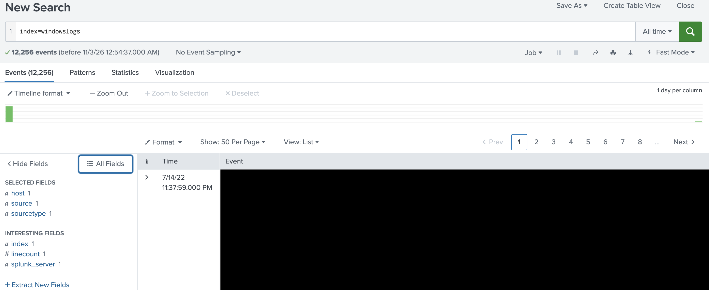
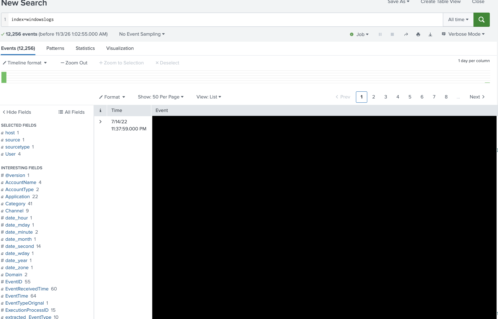

Fast mode skips field discovery, so only internal default fields appear in the sidebar.
The fields still exist and searches like `EventID=10` still work, but Splunk doesn't list them.

**Job Inspector** (Job → Inspect Job) shows how long each part of the search took:

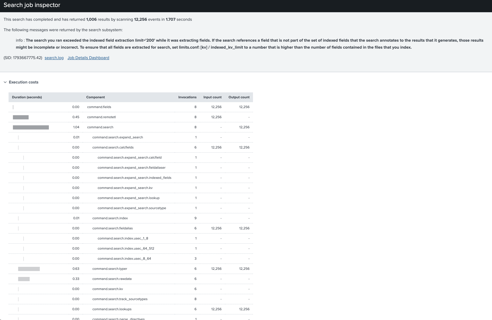

This run scanned 12,256 events in 1.707 seconds.

Finished jobs are kept **10 minutes** by default; sharing extends to **7 days**.

## 2.8 Save search results

**Job menu:**

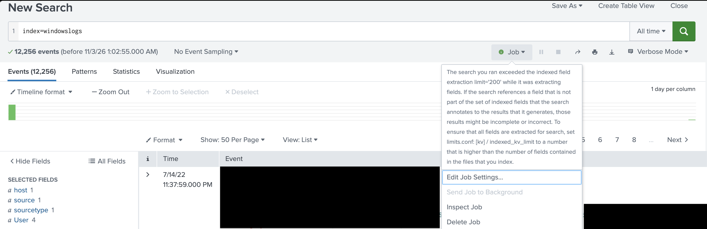

- **Edit Job Settings**: change lifetime (10 min → 7 days) and share the job
- **Send Job to Background**: greyed out here because the search had already finished
- **Inspect Job**: opens the Job Inspector
- **Delete Job**

**Export** (the ↓ icon): CSV, JSON, XML, or raw events. You choose a file name and how many results.

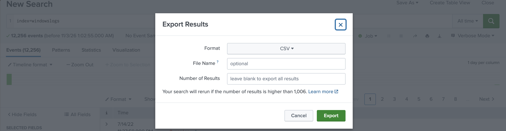

The dialog notes the search will **re-run** if you export more results than the job kept (1,006 here).

**Save As:** Report, Alert, Dashboard Panel, Event Type.

---

### Self-check
1. Why did `powershell or wmi` return 0 events?
2. What is the default time range, and why did it return nothing here?
3. Which timeline actions re-run the search?
4. Why does Fast mode show fewer fields?
5. How long is a job kept by default? When shared?