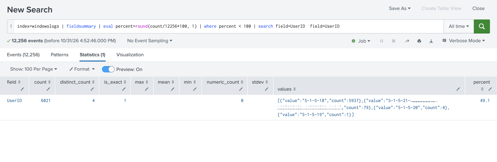
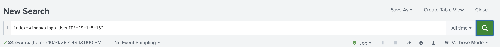
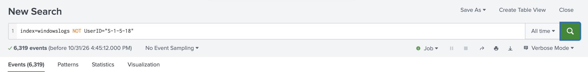

# 3. Using Fields in Searches (20%)

> **In one sentence:** A field is a name=value pair Splunk pulls out of each event, like
> `status=404`; searching on fields is far more precise than searching on raw words.

## 3.1 Understand fields

## 3.1 Understand fields

**Concept:** Fields are extracted at **search time** (schema-on-read).

- **Default fields:** `host`, `source`, `sourcetype`, `index`, `_time`, `_raw` (leading `_` = internal)
- **Automatically extracted:** `key=value` pairs and fields defined for the sourcetype
- Field **names** are case-sensitive; field **values** are not

**Lab demo:** _which fields are missing from some events?_

```spl
index=windowslogs | fieldsummary
| eval percent=round(count/12256*100, 1)
| where percent < 100
| search field=UserID
| table field count distinct_count percent
```



**What it shows:** `UserID` is on only 6,021 of 12,256 events (49.1%). The other
6,235 events have no `UserID` field at all, which matters for the next test.

## 3.2 Use fields in searches

**Concept:**
- `=` / `!=` any value; `<` `>` `<=` `>=` numbers
- Wildcards: `status=4*`
- `status IN (404, 500, 503)`
- Quote values with spaces: `product_name="Dream Crusher"`
- `index` + `sourcetype` + time are the most efficient filters

**Lab demo: the `!=` vs `NOT` test**

`S-1-5-18` is the Windows Local System account, the most common `UserID` value.

```spl
index=windowslogs UserID!="S-1-5-18"
index=windowslogs NOT UserID="S-1-5-18"
```

| Search | Events | What it returns |
| --- | --- | --- |
| `UserID!="S-1-5-18"` | 84 | Events that **have** a UserID that isn't Local System |
| `NOT UserID="S-1-5-18"` | 6,319 | Those 84 **plus** the 6,235 events with no UserID |




**Why the counts differ:** `!=` only matches events where the field exists.
`NOT` matches everything that isn't a match, including events without the field.
Check: 12,256 total − 5,937 Local System = 6,319.

**Control test:** with `EventID`, which is on 100% of events, both searches
returned the same count. The difference only shows when a field is missing from some events.

**Exam trap:** this is the single most tested fields question.
## 3.3 Use the fields sidebar

**Concept:**
- **Selected fields:** shown under every event (default `host`, `source`, `sourcetype`)
- **Interesting fields:** present in **≥ 20%** of events
- **All Fields** link to select more
- `a` = string, `#` = number; the number beside a field = distinct values
- Click a field: top 10 values, plus *Top values*, *Top values by time*, *Rare values*,
  and for numbers *Average/Max/Min over time*

**Result:**
<!-- annotated screenshot of the sidebar and a field window -->

---

### Self-check
1. Name the three default selected fields.
2. What % of events must contain a field for it to be "interesting"?
3. Is `Status=404` the same search as `status=404`?
