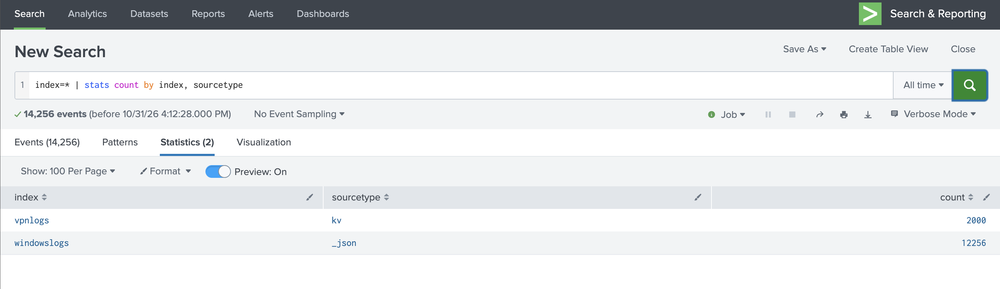

# 4. Search Language Fundamentals (15%)

> **In one sentence:** SPL works like a Unix pipeline — the first part fetches events, and
> each `|` passes results to the next command.

## 4.1 Basic search commands and general practices

**Concept:** Five colour-coded components in the search bar:

| Component | Example | Colour |
| --- | --- | --- |
| Search terms | `failed`, `status=404` | Black |
| Commands | `stats`, `table` | Blue |
| Functions | `count`, `avg()` | Purple |
| Arguments | `limit=5` | Green |
| Clauses | `by`, `as` | Orange |

**Practices:** filter early, be specific, use `index` + `sourcetype` + tight time range,
avoid *All time* and leading wildcards (`*fail`), uppercase Booleans.

## 4.2 The search pipeline

**Query:**

```spl
index=<your_index> sourcetype=<st> status=404
| stats count by uri
| sort -count
| head 10
```

**Result:**
<!-- screenshot -->

**Why it works:** fetch 404s → count per page → sort descending → keep 10. Each command
sees only the previous command's output; after `stats`, raw events are gone.

## 4.3 Specify indexes in searches

***Lab demo:** _what data is in this environment?_

```spl
index=* | stats count by index, sourcetype
```



Two indexes: `windowslogs` (12,256 events, `_json`) and `vpnlogs` (2,000 events, `kv`).
Searching one index directly (`index=windowslogs`) is faster than `index=*`.
## 4.4 table, rename, fields, dedup, sort

| Command | What it does | Example |
| --- | --- | --- |
| `table` | Only listed fields, as columns, in order | `\| table clientip action status` |
| `rename` | Rename fields (quote spaces) | `\| rename clientip AS "Client IP"` |
| `fields` | Keep (`+`) or remove (`-`) fields; faster | `\| fields - _raw` |
| `dedup` | Drop duplicate values, keep the most recent | `\| dedup clientip` |
| `sort` | `-` descending, `+` ascending; 10,000 limit (`sort 0` = none) | `\| sort -bytes` |

**Query (all five together):**

```spl
index=<your_index> sourcetype=<st>
| fields clientip action status
| dedup clientip
| rename clientip AS "Client IP"
| table "Client IP" action status
| sort action
```

**Result:**
<!-- screenshot -->

**Exam traps:**
- After `rename`, later commands must use the **new** name.
- `fields` is for performance; `table` is for display.
- `dedup a b` removes repeats of the **combination**.
- `sort - count` (space after `-`) applies descending to all listed fields.

---

### Self-check
1. What colour are functions in the search bar?
2. Why is `fields` faster than `table`?
3. What happens if you `rename` a field and then reference the old name?
