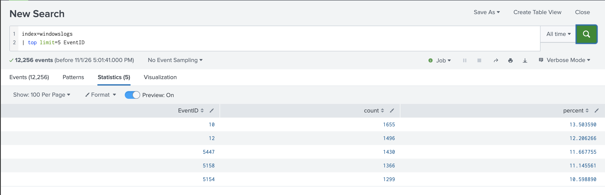
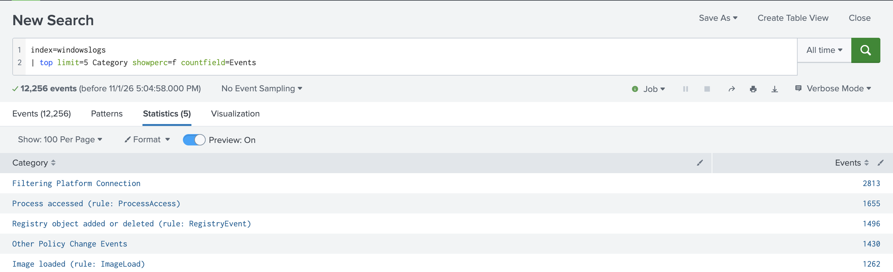
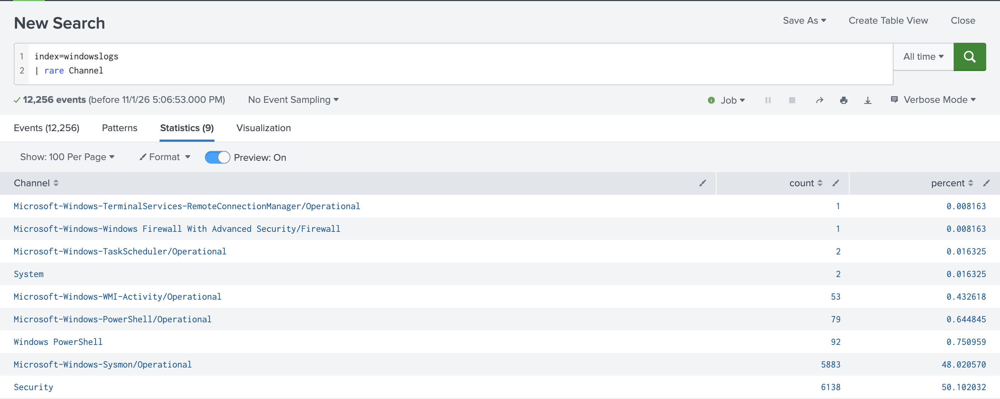
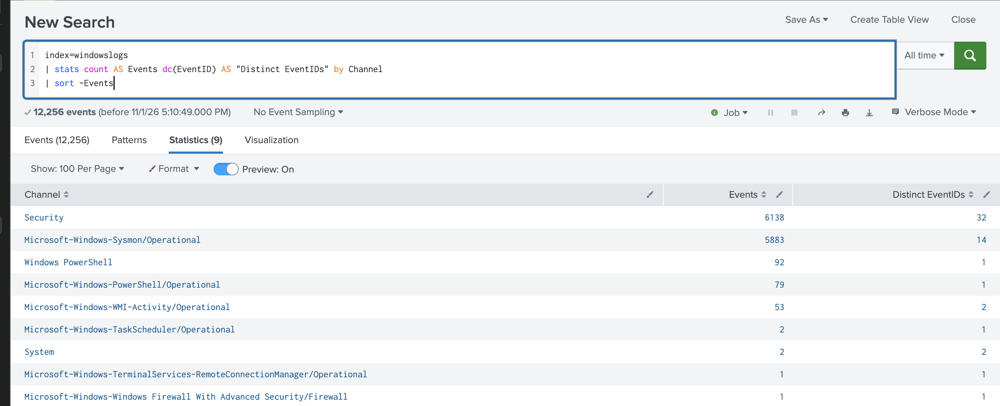
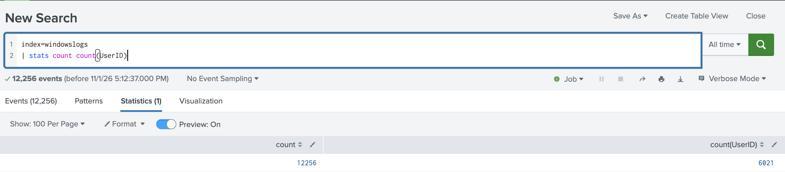

# 5. Basic Transforming Commands (15%)

> **In one sentence:** Transforming commands turn events into a table of numbers, and
> that table feeds every chart and dashboard.

Transforming commands put results on the **Statistics** and **Visualization** tabs.
`top`, `rare`, `stats`, `chart`, `timechart` are all transforming.

## 5.1 top

**Concept:** Most common values with `count` and `percent`. Default **10** results.

| Argument | Effect |
| --- | --- |
| `limit=N` | Number of values (`0` = all) |
| `by field` | Top values per group |
| `countfield=` / `percentfield=` | Rename output columns |
| `showcount=f` / `showperc=f` | Hide a column |
| `useother=t` | Add an OTHER row |

**Lab demo: basic top**

```spl
index=windowslogs | top limit=5 EventID
```



`top` sorted the results by count, added a `percent` column and stopped at 5 rows.

**Lab demo: with arguments**

```spl
index=windowslogs | top limit=5 Category showperc=f countfield=Events
```



`showperc=f` removed the percent column; `countfield=Events` renamed `count` to `Events`.

## 5.2 rare

**Concept:** Least common values. Same arguments and default (10) as `top`.

```spl
index=windowslogs | rare Channel
```



**Why it's useful:** rare values are often the interesting ones in security: an unusual
log channel, a one-off source IP, an event that should almost never happen.

## 5.3 stats

| Function | Returns |
| --- | --- |
| `count` | Number of events |
| `count(field)` | Events that have that field |
| `dc(field)` | Distinct count |
| `sum(field)` | Total |
| `avg(field)` | Mean |
| `min()` / `max()` | Smallest / largest |
| `list(field)` | All values, with duplicates, in order |
| `values(field)` | Unique values, sorted |

**Lab demo: several functions, grouped**

```spl
index=windowslogs
| stats count AS Events dc(EventID) AS "Distinct EventIDs" by Channel
| sort -Events
```



One row per `Channel`, with two calculations each. `AS` renames each output column.

**Lab demo: `count` vs `count(field)`**

```spl
index=windowslogs | stats count count(UserID)
```



| Function | Result | Meaning |
| --- | --- | --- |
| `count` | 12,256 | Every event |
| `count(UserID)` | 6,021 | Only events that have a `UserID` field |

This matches the [3.2 `!=` vs `NOT` test](03-fields.md#32-use-fields-in-searches):
about half the events have no `UserID`.

**Exam traps:**
- `top` adds percent, sorts descending, limits to 10; `stats count by x` returns every value with no percent.
- `values()` is unique and sorted; `list()` keeps duplicates and order.
- `count` counts events; `count(field)` counts only events where that field exists.
---

### Self-check
1. Default number of results for `top` and `rare`?
2. Which function returns a distinct count?
3. How do you rename a `stats` output column?
