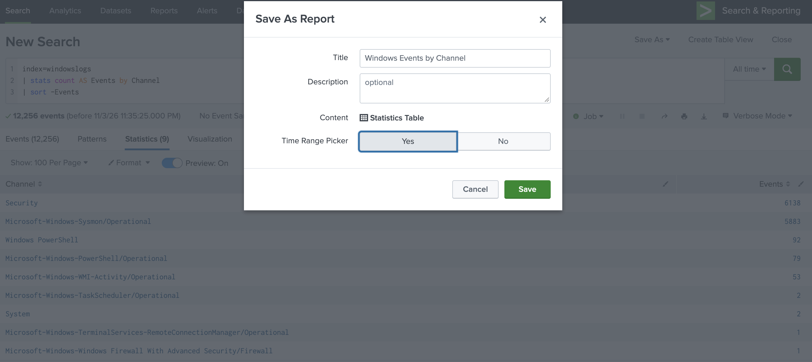
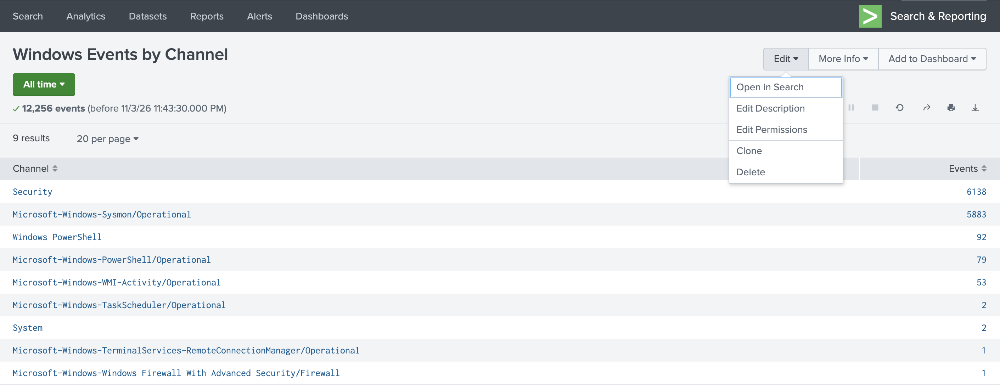
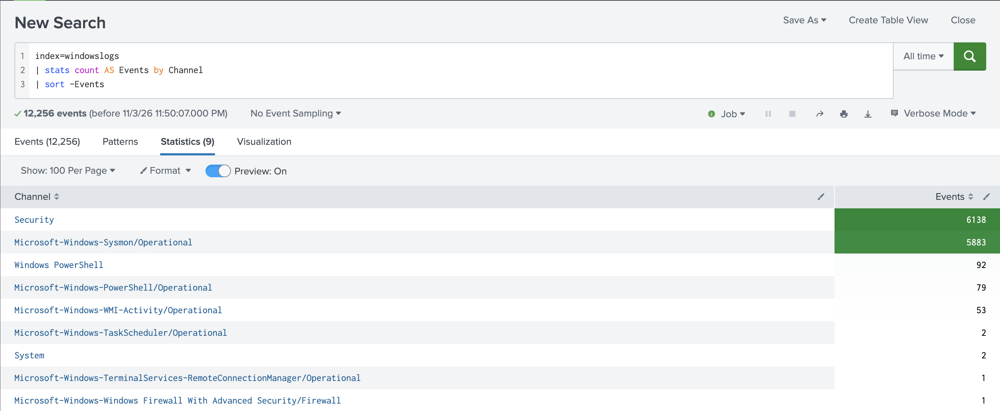
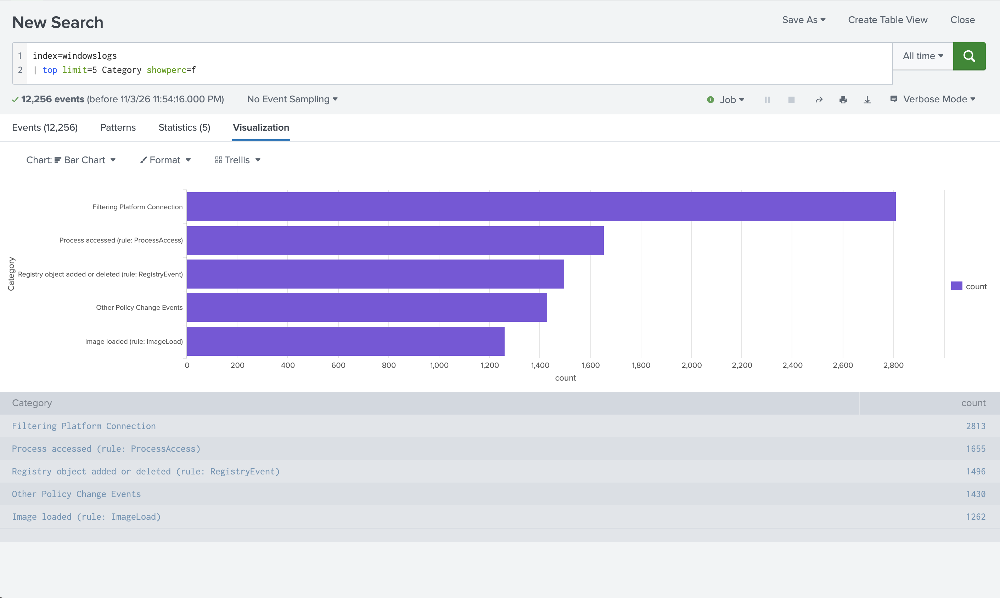
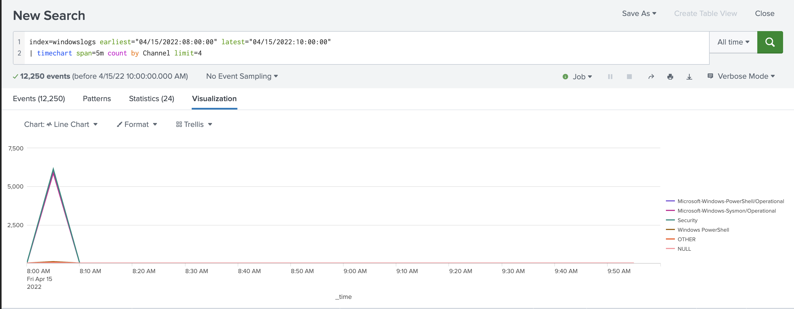
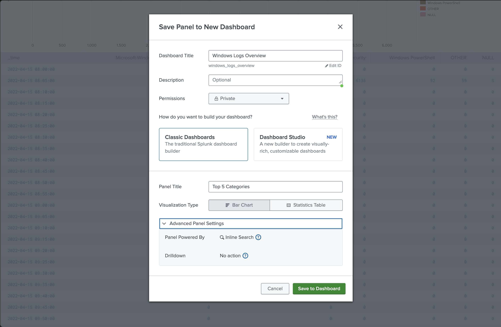
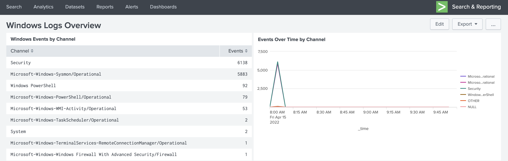

# 6. Creating Reports and Dashboards (12%)

> **In one sentence:** A report is a saved search you re-run with one click; a dashboard
> is a page of panels, each showing a search or report as a table or chart.

What I built: a report (**Windows Events by Channel**) and a dashboard
(**Windows Logs Overview**) with two panels, all from `index=windowslogs`.

## 6.1 Save a search as a report

**Concept:** **Save As → Report**: title, description, content (Statistics table or
Visualization), optional Time Range Picker. Reports re-run each time they're opened unless
scheduled or accelerated.

**Report I saved:**

```spl
index=windowslogs
| stats count AS Events by Channel
| sort -Events
```



- **Content: Statistics Table**: Splunk chose this because the search ends in `stats`
- **Time Range Picker: Yes**: anyone opening the report can change the time range

## 6.2 Edit reports

**Concept:** Open a report → **Edit** menu. **Edit Search** (or *Open in Search*) changes the SPL.
Permissions: run as Owner or User; Private / This app / All apps; Read/Write per role.



| Option | What it does |
| --- | --- |
| Open in Search | Opens the report's search so the SPL can be changed |
| Edit Description | Change the description |
| Edit Permissions | Private, this app, or all apps; who can read/write |
| Clone | Copy the report as a starting point for a new one |
| Delete | Remove it |

Schedule and acceleration options live in the same **Edit** menu on the **Reports** list page.

## 6.3 Reports that display statistics (tables)

**Concept:** Any transforming search → Statistics tab. Format via the column paintbrush
(precision, colour scales, data bars) and table settings.

**Lab demo:** paintbrush on the `Events` column → **Color → Scale**:



The colour scale shows at a glance that two channels (Security: 6,138; Sysmon: 5,883)
hold 98% of all events.

## 6.4 Reports that display visualizations (charts)

**Concept:** Column, bar, line, area, pie, scatter, single value, gauge, map.
- `timechart` puts `_time` on the X-axis (line/area over time).
- Pie charts show one series.
- **Pivot** (Datasets) builds charts point-and-click from a data model.

**Bar chart: comparing categories**

```spl
index=windowslogs | top limit=5 Category showperc=f
```



A bar chart suits a ranked list: one bar per category, longest first.

**Line chart: change over time**

```spl
index=windowslogs earliest="04/15/2022:08:00:00" latest="04/15/2022:10:00:00"
| timechart span=5m count by Channel limit=4
```



- `span=5m` makes one row per 5 minutes: 2 hours = **24 rows** (the Statistics tab shows 24)
- `limit=4` keeps the 4 biggest channels; the rest are grouped as **OTHER**
- **NULL** = events with no `Channel` field. In the 08:05 bucket NULL = **5**, the same 5
  events that `stats ... by Channel` silently dropped in [domain 5](05-transforming-commands.md).
  `stats by` drops them; `timechart by` shows them as NULL.
- Nearly all activity sits in one 5-minute spike at 08:05.

**Exam trap:** chart a `timechart` as a line or column chart, not a bar chart. A horizontal
bar chart puts `_time` on the vertical axis.

## 6.5 Create a dashboard

**Concept:** **Save As → Dashboard Panel** (or **Dashboards → Create New Dashboard**): title,
ID, description, permissions. Two frameworks: **Classic (Simple XML)** and **Dashboard Studio** (JSON).



- **Dashboard Title** → Splunk generated the **ID** `windows_logs_overview` (used in the URL)
- **Permissions: Private** until shared
- **Classic Dashboards** chosen
- **Visualization Type:** Bar Chart or Statistics Table
- **Panel Powered By: Inline Search**

## 6.6 Add a report to a dashboard

**Concept:** A panel is powered by either:

| Panel type | Where the SPL lives | If the source changes |
| --- | --- | --- |
| **Inline search** | Inside the dashboard panel | Edit it in the dashboard |
| **Report** | In the saved report | Changes to the report flow through to the panel |

I added the **Windows Events by Channel** report with **Add to Dashboard → Existing**, so that
panel is report-powered; the chart panel is an inline search.

## 6.7 Edit a dashboard

**Concept:** **Edit**: drag panels by the dotted bar at the top of each panel, add panels,
add inputs (time picker, dropdown, text) that pass tokens to searches, change the chart type
(**Chart:** menu on each panel), rename panels, edit source, **Save**.

What I changed in edit mode:
1. Dragged the table panel next to the chart so both share one row
2. Switched the time panel from Bar to **Line** chart
3. Gave each panel a title and removed a leftover duplicate title

**Finished dashboard:**



| Panel | Type | Powered by | Search |
| --- | --- | --- | --- |
| Windows Events by Channel | Statistics table | Report | `stats count AS Events by Channel \| sort -Events` |
| Events Over Time by Channel | Line chart | Inline search | `timechart span=5m count by Channel limit=4` |

---

### Self-check
1. Inline search panel vs. report panel: what's the difference?
2. Which command puts `_time` on the X-axis?
3. Name the two dashboard frameworks.
4. What do OTHER and NULL mean in a `timechart ... by` legend?
5. Why did Splunk pick "Statistics Table" as the report content?