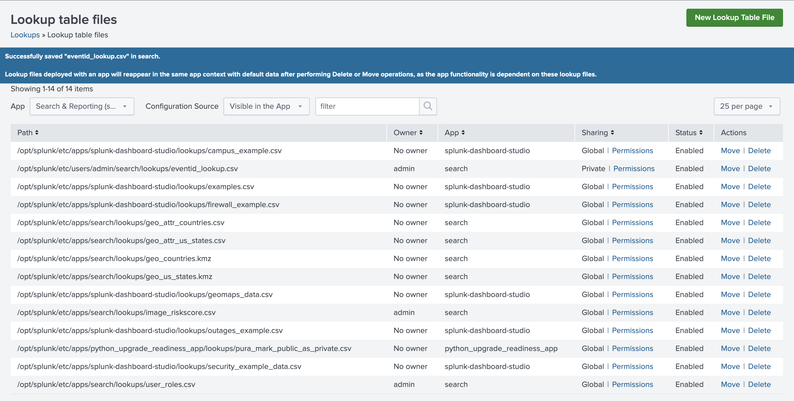
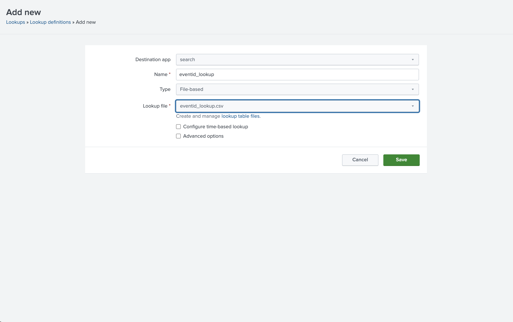
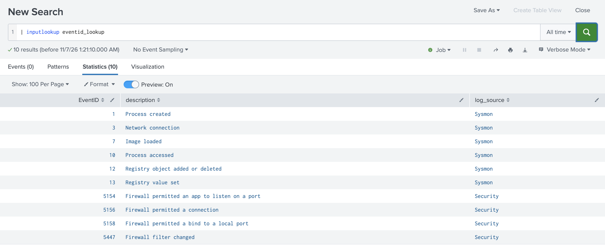
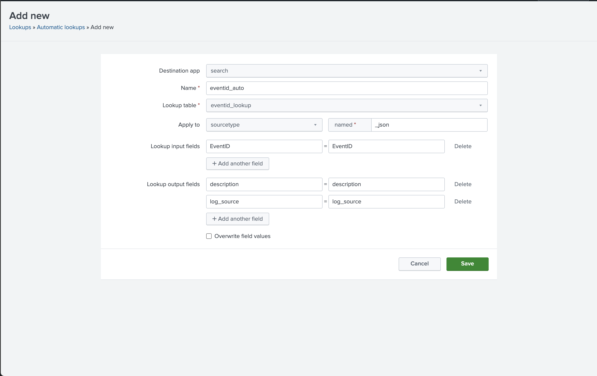
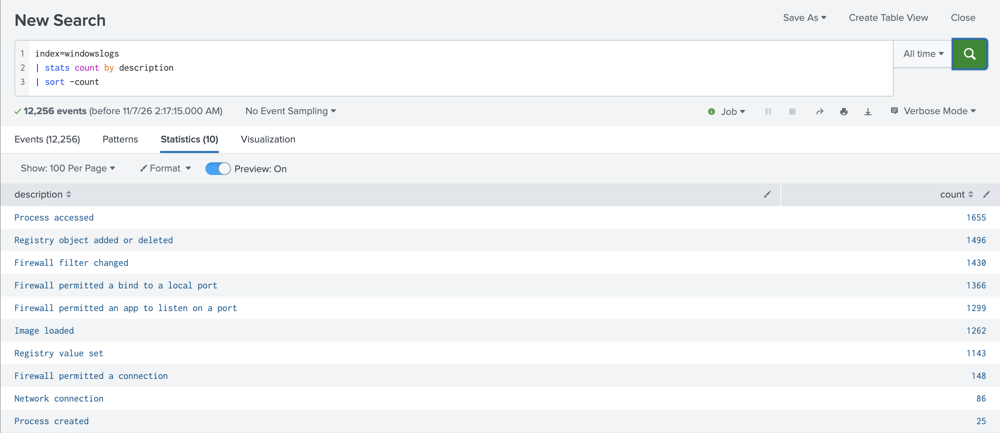
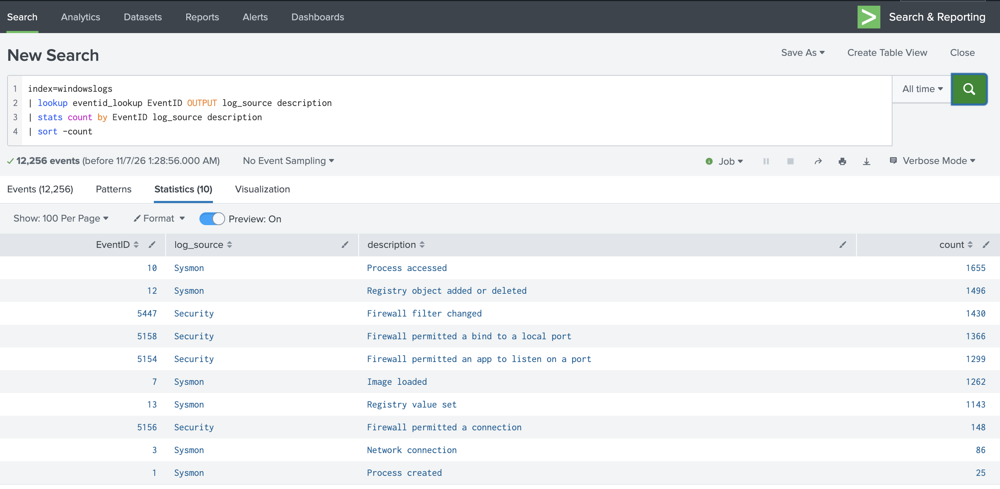

# 7. Creating and Using Lookups (6%)

> **In one sentence:** A lookup is a reference table, usually a CSV, that Splunk joins
> onto events so a code in the log becomes a readable name or value.

What I built: a CSV that turns Windows Event IDs into plain-English descriptions, then an
automatic lookup that adds those descriptions to every `windowslogs` event.

## 7.1 Describe lookups

**Concept:** Lookups add fields at search time and **don't change indexed data**.
Types: CSV file (most common), KV store, external (script), geospatial.

Why it's useful here: `EventID=5158` means nothing at a glance; "Firewall permitted a bind
to a local port" does.

## 7.2 Examine a lookup file example

The header row holds field names; one column (`EventID`) matches a field already in the events.

**My lookup file:** [`lookups/eventid_lookup.csv`](lookups/eventid_lookup.csv). Descriptions
are public Windows / Sysmon event meanings, written by me.

```csv
EventID,log_source,description
1,Sysmon,Process created
3,Sysmon,Network connection
7,Sysmon,Image loaded
10,Sysmon,Process accessed
12,Sysmon,Registry object added or deleted
13,Sysmon,Registry value set
5154,Security,Firewall permitted an app to listen on a port
5156,Security,Firewall permitted a connection
5158,Security,Firewall permitted a bind to a local port
5447,Security,Firewall filter changed
```

**Lesson learned:** my first version had spaces after the commas (`EventID, log_source`),
which would create field names with a leading space. Header names must match exactly.

## 7.3 Create a lookup file and a lookup definition

**Concept:** Two steps under **Settings → Lookups**:
1. **Lookup table files → New:** upload the CSV (name ends `.csv`)
2. **Lookup definitions → New:** name, type *File-based*, select the file. Searches use the **definition** name.




**Verify:**

```spl
| inputlookup eventid_lookup
```



`inputlookup` reads the lookup as a table, a quick check that the file and definition load.

## 7.4 Configure an automatic lookup

**Concept:** **Settings → Lookups → Automatic lookups → New:** definition, **sourcetype**,
input field (lookup ↔ event), output fields. Fields then appear on every event of that
sourcetype with no `lookup` command.

| Setting | Value |
| --- | --- |
| Name | `eventid_auto` |
| Lookup table | `eventid_lookup` (the definition, not the `.csv`) |
| Apply to | sourcetype `_json` |
| Input | `EventID` = `EventID` |
| Output | `description`, `log_source` |

Splunk stored it as:
`eventid_lookup "EventID=EventID" OUTPUTNEW "description=description" "log_source=log_source"`



**Test, with no `lookup` command in the search:**

```spl
index=windowslogs | stats count by description | sort -count
```



| description | count |
| --- | --- |
| Process accessed | 1,655 |
| Registry object added or deleted | 1,496 |
| Firewall filter changed | 1,430 |
| … (10 rows total) | |

These match the `top EventID` counts from [domain 5](05-transforming-commands.md): EventID 10 =
1,655, EventID 12 = 1,496. The 10 rows total **9,910** events; the other 2,346 have Event IDs
not in my CSV, so they get no description and `stats by` drops them.

### Troubleshooting: "Could not load lookup"


The first run failed with `Could not load lookup=LOOKUP-eventid_auto`. The configuration was
correct; the problem was **permissions**. The file, definition and automatic lookup were all
**Private**. Changing each to **This app only (search)**, with Read for Everyone, fixed it.

**Checklist when a lookup fails:**
1. Does `| inputlookup <definition>` work? If not, the file or definition is the problem.
2. Do the supported fields match the CSV header exactly?
3. Does the automatic lookup point at the **definition** name, in the same app?
4. Are all three objects shared at App level?

## 7.5 Use the lookup in searches

**Manual lookup, without relying on the automatic one:**

```spl
index=windowslogs
| lookup eventid_lookup EventID OUTPUT log_source description
| stats count by EventID log_source description
| sort -count
```



- Different field names: `| lookup <def> <lookup_field> AS <event_field> OUTPUT ...`
- `OUTPUT` overwrites existing fields; `OUTPUTNEW` only fills empty ones (automatic lookups default to `OUTPUTNEW`).
- `inputlookup` reads a lookup; `outputlookup` writes results to one.

---

### Self-check
1. Do lookups change indexed data?
2. Which two objects must exist before a CSV lookup can be used?
3. What name does a search use: the file name or the definition name?
4. `OUTPUT` vs `OUTPUTNEW`?
5. An automatic lookup returns "Could not load lookup". Name two things to check.