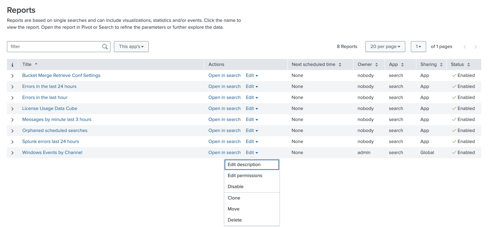

# 8. Creating Scheduled Reports and Alerts (5%)

> **In one sentence:** A scheduled report runs on a timer and delivers results; an alert
> also runs on a timer (or in real time) but only acts when a condition is met.

> **Lab note:** the TryHackMe Splunk lab disables scheduling for its user. The report
> **Edit** menu has no *Edit Schedule* or *Edit Acceleration* options:
>
> 
>
> This section covers the concepts, plus the exact configuration I would use on my lab data.

## 8.1 Describe scheduled reports

**Concept:** A report that runs automatically on a schedule instead of when someone opens it.

Use them to:
- **Deliver results:** email a daily summary, write results to a lookup, call a webhook
- **Speed up dashboards:** panels powered by a scheduled report show the last cached result instead of re-running the search
- **Spread load:** move heavy searches to quiet hours

A scheduled report runs as its **owner** (with the owner's permissions).

## 8.2 Configure scheduled reports

**Where:** Reports → **Edit ▾ → Edit Schedule** → tick **Schedule Report**

| Setting | Options | Notes |
| --- | --- | --- |
| Schedule | Run every hour / day / week / month, or **Run on Cron Schedule** | Cron gives full control |
| Time Range | Any range, e.g. Last 24 hours | The window of data each run covers |
| Schedule Priority | Default, Higher, Highest | Which runs go first when the system is busy |
| Schedule Window | No window, a fixed number of minutes, or Auto | Lets Splunk delay the run to balance load |
| Trigger Actions | Send email, Log event, Output results to lookup, Run a script, Webhook | What happens with the results |

**Cron basics:** five fields, `minute hour day-of-month month day-of-week`

| Cron | Meaning |
| --- | --- |
| `*/5 * * * *` | Every 5 minutes |
| `0 * * * *` | Every hour, on the hour |
| `0 6 * * *` | 06:00 every day |
| `0 6 * * 1` | 06:00 every Monday |
| `0 0 1 * *` | Midnight on the 1st of each month |

**What I would schedule:** the **Windows Events by Channel** report from [domain 6](06-reports-dashboards.md).

| Setting | Value |
| --- | --- |
| Search | `index=windowslogs \| stats count AS Events by Channel \| sort -Events` |
| Schedule | Cron `0 6 * * *` (daily 06:00) |
| Time Range | Last 24 hours |
| Priority | Default |
| Action | Send email with the results table |

## 8.3 Describe alerts

**Concept:** Alert = saved search + **trigger condition** + **actions**. It runs on a schedule
(or continuously) and only acts when the condition is true.

| Type | How it runs | Cost |
| --- | --- | --- |
| **Scheduled** | Runs on a schedule (cron), checks the condition each run | Lower; the most common type |
| **Real-time** | Runs continuously; triggers **per result** or over a **rolling window** (e.g. 10 events in 5 minutes) | Higher: a search that never stops |

## 8.4 Create alerts

**Where:** run a search → **Save As → Alert**

1. **Title, description, permissions** (Private or Shared in App)
2. **Alert type:** Scheduled or Real-time, plus the schedule
3. **Expires:** how long a triggered alert record is kept (default **24 hours**)
4. **Trigger condition:**
   - Number of Results, Number of Hosts, or Number of Sources
   - compared with *is greater than, is less than, is equal to, is not equal to, drops by, rises by*
   - or **Custom**: a search condition such as `search count > 1000`
5. **Trigger:** **Once** per run, or **For each result**
6. **Throttle:** suppress repeat triggers for a period (e.g. 60 minutes), optionally per field value
7. **Trigger actions:** Add to Triggered Alerts (with **severity**), Send email, Log event,
   Output results to lookup, Run a script, Webhook

**Alert I designed:** high volume of firewall connection events.

```spl
index=windowslogs Category="Filtering Platform Connection" | stats count
```

| Setting | Value |
| --- | --- |
| Type | Scheduled, cron `*/15 * * * *` |
| Time range | Last 15 minutes |
| Condition | Custom: `search count > 1000` |
| Trigger | Once |
| Throttle | 60 minutes, so one burst doesn't send dozens of alerts |
| Actions | Add to Triggered Alerts (severity **Medium**) + Send email |

On my lab data this category has **2,813** events (see [domain 5](05-transforming-commands.md)),
almost all within one 5-minute window ([domain 6 timechart](06-reports-dashboards.md)), so this
alert would have fired during that burst.

## 8.5 View fired alerts

**Where:** **Activity → Triggered Alerts**

- Lists alerts that fired, with time, app, severity and type
- An alert only appears here if it has the **Add to Triggered Alerts** action
- **Severity** levels: Info, Low, Medium, High, Critical
- Records are kept until the alert's **Expires** time (default 24 hours)
- **Alerts** (app bar) lists all alerts; open one to see its history and edit it

**Exam traps:**
- No "Add to Triggered Alerts" action → nothing appears in Triggered Alerts, even if the alert fired
- Real-time alerts cost more than scheduled ones
- Throttling suppresses *repeat* triggers; it doesn't change the condition

---

### Self-check
1. Which action is required for an alert to show in Triggered Alerts?
2. Scheduled vs real-time alert: which uses more resources?
3. What does throttling do?
4. Write a cron expression for 06:00 every Monday.
5. What are the four built-in trigger condition types?